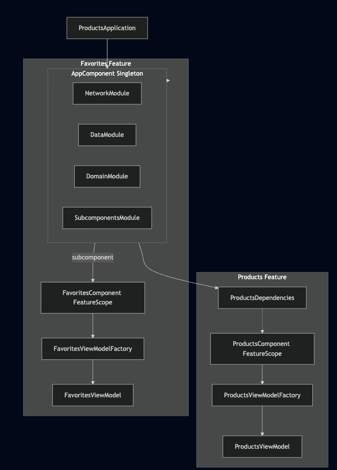

# Результат выполнения задания: Внедрение Dagger 2

Приложение было переведено с паттерна Service Locator на Dependency Injection с использованием Dagger 2.

### Структура DI-графа:

[Посмотреть диаграмму в текстовом формате](di_graph.mmd)

### Выполненные работы:

1.  **Создан AppComponent (Singleton):**
    *   Является основным компонентом приложения.
    *   Предоставляет сетевые зависимости (Retrofit, OkHttp, ProductApiService), репозитории и Use Case'ы.
    *   Реализует интерфейс `ProductsDependencies`.
    *   Включает `SubcomponentsModule` для работы с сабкомпонентами.
    *   Инициализируется в `ProductsApplication`.

2.  **Реализована фича Products (Component Dependencies):**
    *   Создан `ProductsComponent` с областью видимости `@FeatureScope`.
    *   Использует `ProductsDependencies` как внешнюю зависимость.
    *   Предоставляет `ProductsViewModelFactory`.

3.  **Реализована фича Favorites (Subcomponent):**
    *   Создан `FavoritesComponent` как сабкомпонент `AppComponent`.
    *   Имеет область видимости `@FeatureScope`.
    *   Предоставляет `FavoritesViewModelFactory`.

4.  **Рефакторинг кода:**
    *   `ServiceLocator` полностью удален.
    *   Все репозитории, Use Case'ы и фабрики состояний переведены на использование конструкторной инъекции (`@Inject`).
    *   ViewModels теперь получают свои зависимости через конструктор.
    *   Компоненты в Compose-экранах создаются с использованием `remember` и вспомогательных функций поиска зависимостей.
    *   Сбор состояния во ViewModels в Composable-функциях переведен на использование `collectAsStateWithLifecycle()` для безопасной работы с жизненным циклом.
    *   Исправлено использование `modifier` в Composable-функциях для корректной передачи параметров оформления.

5.  **Инфраструктура DI:**
    *   В модуле `common:di` добавлены интерфейсы `Dependencies`, `DependenciesProvider` и расширение `findDependencies`.
    *   Используется аннотация `@FeatureScope` для управления временем жизни компонентов фич.

Все новые классы и функции снабжены документацией на русском языке. Проект успешно собирается.
